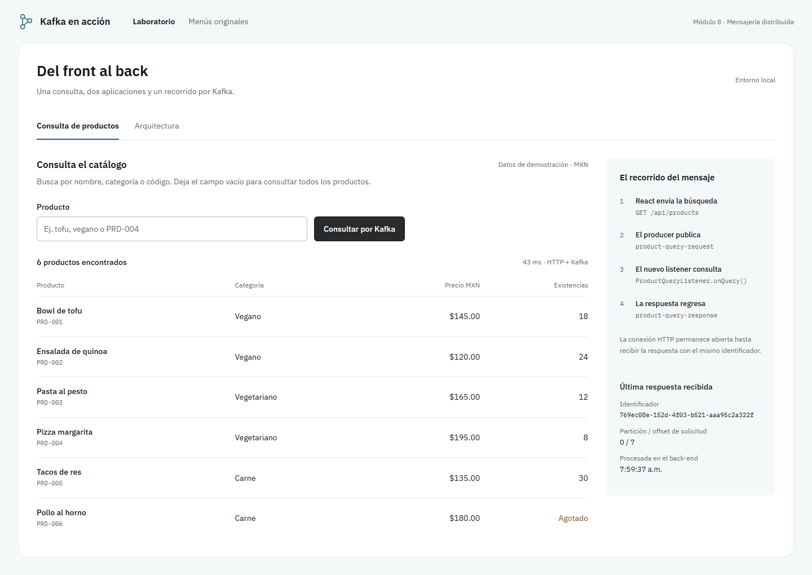
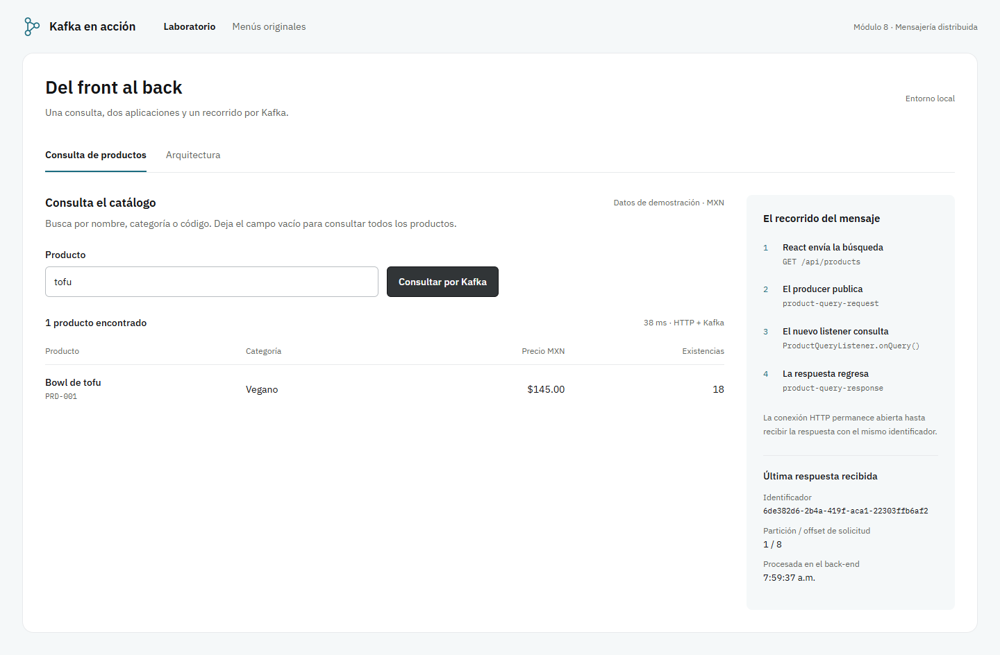
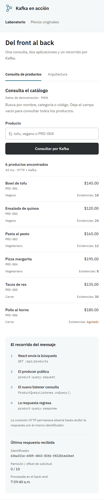
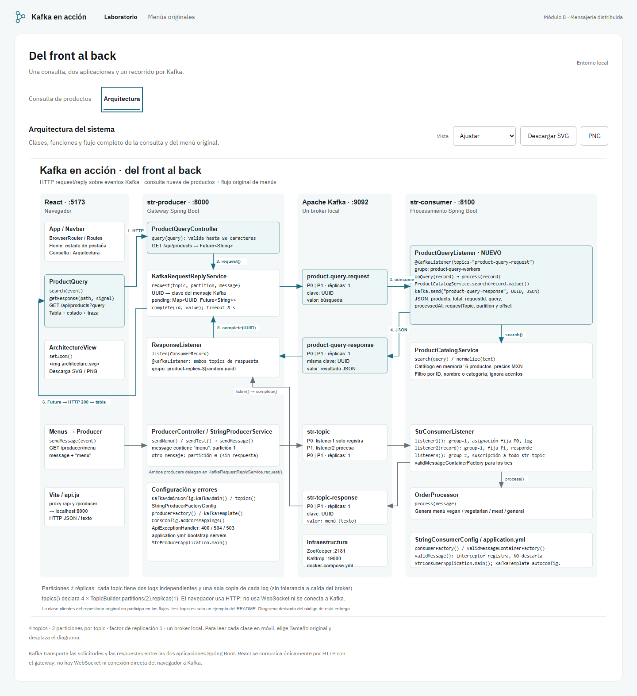
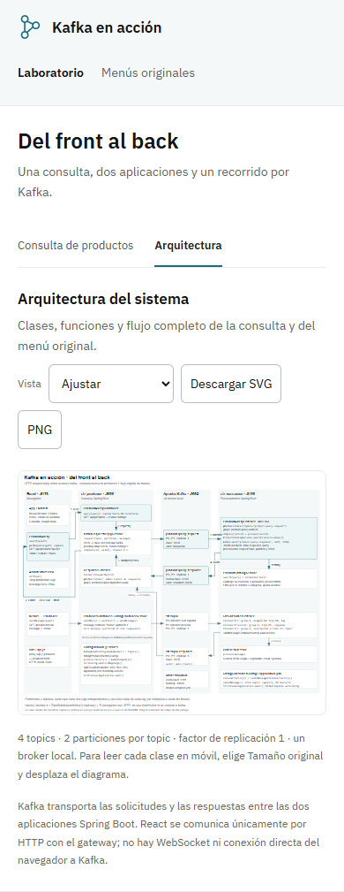
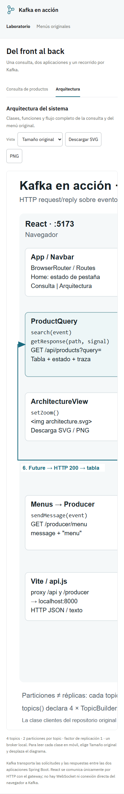
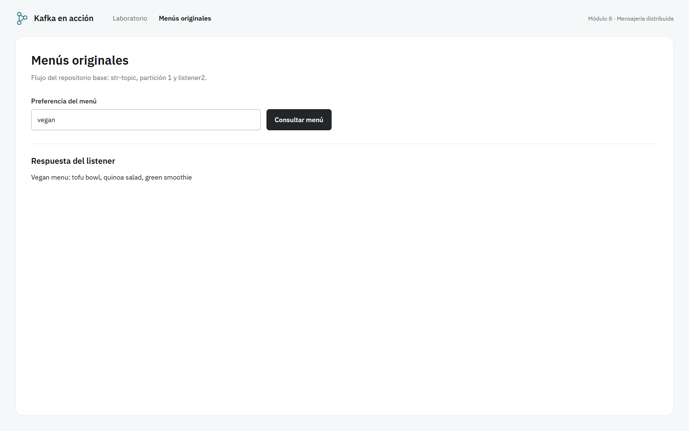

# Evidencia de ejecución · 20 de octubre de 2026

Sistema real en Windows: React/Vite (:5174 durante esta verificación), gateway Spring Boot (:8000), consumer Spring Boot (:8100), Kafka Docker (:9092), ZooKeeper y Kafdrop (:19000).

## Resultados

- **9/9 pruebas Java aprobadas**: ProductCatalogServiceTest (1), StrConsumerApplicationTests (1), KafkaRequestReplyServiceTest (1), ProductQueryIntegrationTest (5), StrProducerApplicationTests (1). Los archivos `com.*.txt` son reportes Surefire de la compilación final. Kafka embebido permite repetirlas sin Docker.
- **6/6 pruebas Playwright aprobadas**, con broker Docker real: consulta completa/filtro/correlación; acentos y sin coincidencias; pestañas por teclado/diagrama/ampliación; móvil sin desbordamiento; menú original; estado de error. `ui-results.json` conserva el reporte. Únicamente la prueba de error visual inyecta HTTP 503; todas las respuestas de éxito provienen del sistema real.
- `api-results.json`: 8 peticiones HTTP verificadas contra el sistema Docker, incluyendo dos simultáneas con UUID distintos, respuesta 400 por longitud y 504 cuando se envía a la partición que solo registra.
- `topics.txt`: salida de `kafka-topics --describe`, confirma los cuatro topics, 2 particiones y RF1.
- `containers.txt`: servicios Docker levantados.
- `baseline-menu.txt`: respuesta recibida del back-end original antes de sustituirlo por la versión ampliada. El front original no compilaba por la dependencia react-router-dom no declarada; se corrigió y el flujo original volvió a verificarse en navegador.
- `npm run lint` y `npm run build`: aprobados. `npm audit fix` aplicó actualizaciones compatibles; auditoría final: 0 vulnerabilidades.

## Capturas

Las capturas son reales. Los productos y sus cantidades son datos de demostración del catálogo en memoria del back-end, no pruebas de inventario comercial. Los UUID, offsets, tiempos y resultados corresponden a las consultas ejecutadas.

## Revisión visual

Taste framed-sheet, semilla 317644511, sin redibujos. Firma: recorrido del mensaje al lado de la respuesta con UUID/partición/offset. Preguntas de las vistas: qué productos coinciden y cómo viaja la consulta. Inspector: 0 fallos y un aviso de metadatos bajo 13px, aceptado para IDs/código y datos secundarios. Revisión independiente: dos barreras móviles detectadas y resueltas (precio/existencias y diagrama a 2200px). Veredicto de la tanda: ship. El motor binario Impeccable no estaba disponible; el contexto y la revisión se realizaron leyendo código, reglas y capturas.

No se ejecutó una prueba con lector de pantalla. La navegación con teclado sí se comprobó en Playwright. RF1 y catálogo en memoria corresponden al alcance educativo solicitado.
